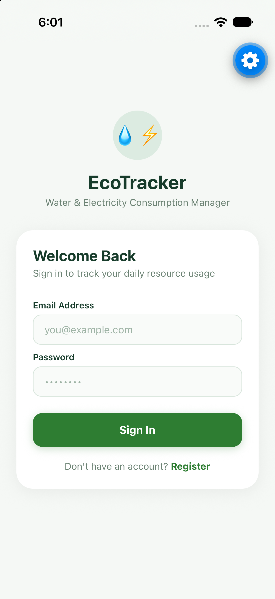
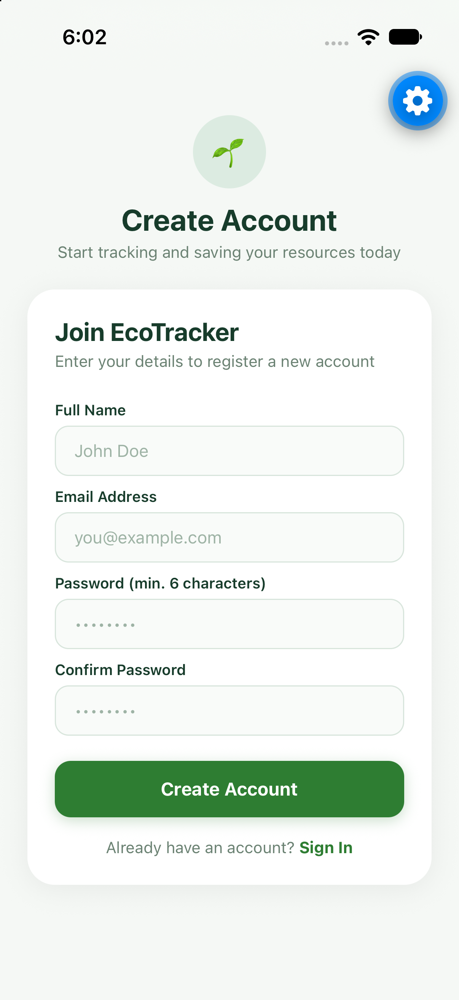
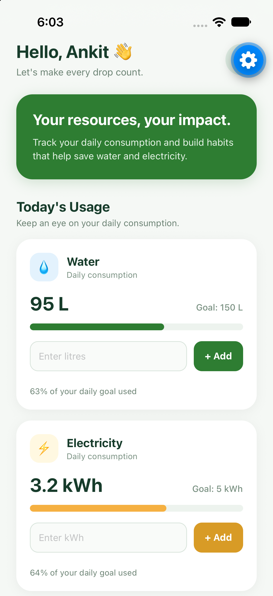
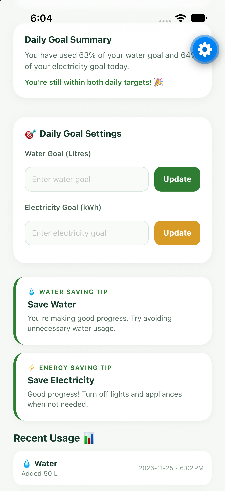
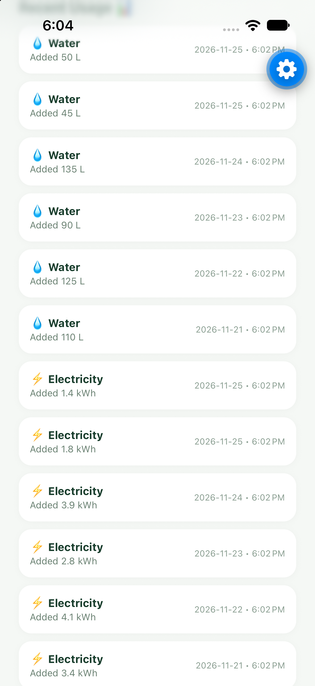
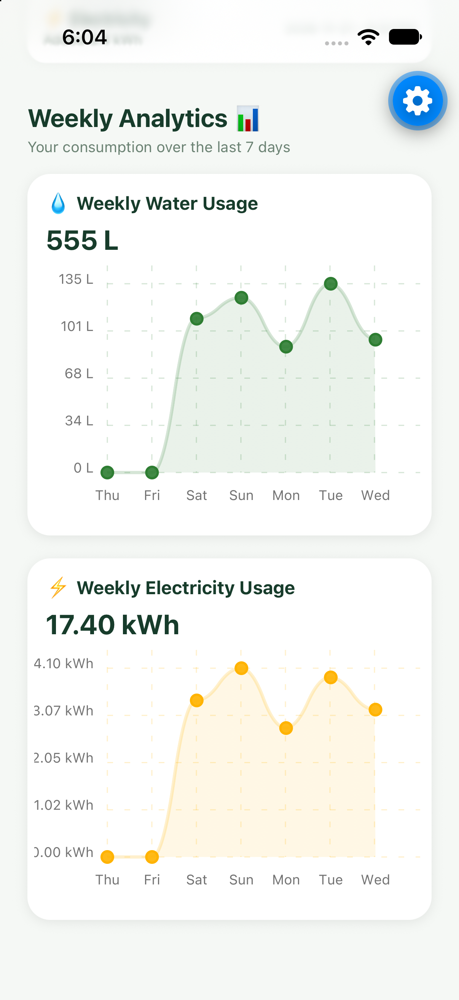

# Water & Electricity Tracker (EcoTracker)

A full-stack mobile application built with **React Native (Expo)**, **Node.js / Express**, and **PostgreSQL** to help users track daily water and electricity consumption, monitor progress against daily goals, and view 7-day usage analytics.

## Features

- **User Authentication:** Register, log in, and restore sessions securely using `bcryptjs` password hashing, JWT tokens, and `expo-secure-store`.
- **Water & Electricity Tracking:** Log daily water (Litres) and electricity (kWh) usage with PostgreSQL as the source of truth.
- **Daily Goals & Tips:** Set and persist daily water and electricity goals locally via `AsyncStorage`, with progress bars and dynamic saving tips.
- **Recent History & Weekly Analytics:** View chronological consumption history (India timezone `Asia/Kolkata`) and 7-day trend charts via `react-native-chart-kit`.
- **User Isolation & Validation:** All consumption routes are protected by JWT middleware, scoped to `req.user.userId`, and validated on both frontend and backend.

## Tech Stack

- **Frontend:** React Native, Expo (`~58`), Axios, Expo SecureStore, AsyncStorage, React Native Chart Kit
- **Backend:** Node.js, Express (`^5`), PostgreSQL (`pg`), JSON Web Tokens (`jsonwebtoken`), `bcryptjs`, `dotenv`

## Project Structure

```text
water-electricity-tracker/
├── App.js
├── app.json
├── index.js
├── package.json
├── src/
│   ├── context/
│   │   └── AuthContext.js
│   ├── screens/
│   │   ├── DashboardScreen.js
│   │   ├── LoginScreen.js
│   │   └── RegisterScreen.js
│   └── services/
│       └── api.js
└── backend/
    ├── .env.example
    ├── package.json
    └── src/
        ├── app.js
        ├── server.js
        ├── config/
        │   ├── db.js
        │   └── schema.sql
        ├── middleware/
        │   └── auth.js
        ├── routes/
        │   ├── auth.js
        │   ├── electricity.js
        │   └── water.js
        └── utils/
            └── validators.js
```

## Prerequisites

- **Node.js** (v18 or newer) and **npm**
- **PostgreSQL** (v14 or newer)
- **Expo Go** app installed on your Android or iOS device
- **Cloudflare CLI (`cloudflared`)** for exposing your local backend to a physical device

## Database Schema

The PostgreSQL database (`water_electricity_tracker`) uses four tables defined in `backend/src/config/schema.sql`:

- **`users`**: Stores registered user accounts (`id`, `name`, `email` unique, `password_hash`, `created_at`).
- **`water_usage`**: Stores water consumption entries in Litres (`id`, `user_id` FK → `users.id` with `ON DELETE CASCADE`, `amount > 0`, `usage_date`, `created_at`), indexed by `(user_id, usage_date)`.
- **`electricity_usage`**: Stores electricity consumption entries in kWh (`id`, `user_id` FK → `users.id` with `ON DELETE CASCADE`, `amount > 0`, `usage_date`, `created_at`), indexed by `(user_id, usage_date)`.
- **`goals`**: Schema table for user goals (`user_id` unique FK → `users.id`); in the current version, daily goals are persisted locally on the device via `AsyncStorage` per user ID.

## Setup Instructions

### 1. Database Setup (PostgreSQL)

Create the database and apply the schema:

```bash
createdb water_electricity_tracker
psql -d water_electricity_tracker -f backend/src/config/schema.sql
```

### 2. Backend Setup

```bash
cd backend
npm install
cp .env.example .env
```

Edit `backend/.env` with your PostgreSQL credentials and a secure `JWT_SECRET`, then start the server:

```bash
npm run dev
```

The backend runs on port `5001` by default (`http://localhost:5001/api/health`).

### 3. Cloudflare Quick Tunnel (For Physical Phone / Expo Go)

Expose your local backend on port `5001`:

```bash
cloudflared tunnel --url http://localhost:5001
```

Copy the generated `https://*.trycloudflare.com` URL and update `API_BASE_URL` in `src/services/api.js`.

### 4. Frontend Setup (Expo)

From the repository root:

```bash
npm install
npx expo start
```

Scan the QR code with **Expo Go** on your physical phone.

### Running the Application

Keep three terminal windows open:

| Terminal | Directory | Command |
|---|---|---|
| Terminal 1 – Backend | `backend/` | `npm run dev` |
| Terminal 2 – Cloudflare | Project root | `cloudflared tunnel --protocol http2 --url http://localhost:5001` |
| Terminal 3 – Frontend | Project root | `npx expo start` |

All three processes must remain running while using the application.

If the Cloudflare Quick Tunnel URL changes, update `API_BASE_URL` in `src/services/api.js` and restart the Expo app if necessary.

## API Endpoints

| Method | Endpoint | Auth | Description |
|---|---|---|---|
| `GET` | `/api/health` | Public | Backend health check |
| `POST` | `/api/auth/register` | Public | Register a new user |
| `POST` | `/api/auth/login` | Public | Authenticate user and return JWT |
| `GET` | `/api/auth/me` | Bearer JWT | Get authenticated user profile |
| `POST` | `/api/water` | Bearer JWT | Add water consumption entry |
| `GET` | `/api/water/today` | Bearer JWT | Get today's total water usage (IST) |
| `GET` | `/api/water/history` | Bearer JWT | Get water usage history (newest first) |
| `POST` | `/api/electricity` | Bearer JWT | Add electricity consumption entry |
| `GET` | `/api/electricity/today` | Bearer JWT | Get today's total electricity usage (IST) |
| `GET` | `/api/electricity/history` | Bearer JWT | Get electricity usage history (newest first) |

## Troubleshooting

- **Cloudflare Tunnel Error 1033 / 502 or Network Timeout:** Quick Tunnel URLs expire when `cloudflared` stops. Restart `cloudflared tunnel --url http://localhost:5001`, ensure the backend is running on port `5001`, and update `API_BASE_URL` in `src/services/api.js`.
- **Database Connection Failed:** Verify PostgreSQL is running and `DB_HOST`, `DB_PORT`, `DB_NAME`, `DB_USER`, and `DB_PASSWORD` in `backend/.env` match your local setup.
- **`JWT_SECRET` Startup Error:** Ensure `JWT_SECRET` is set to a non-empty string in `backend/.env`.

## Screenshots

Screenshots of EcoTracker running in Expo Go.

### 1. Authentication

**Login Screen**



**Registration Screen**



### 2. Dashboard

**Dashboard Overview**



**Daily Goals and Saving Tips**



### 3. Usage History and Analytics

**Recent Usage History**



**Weekly Analytics Charts**

